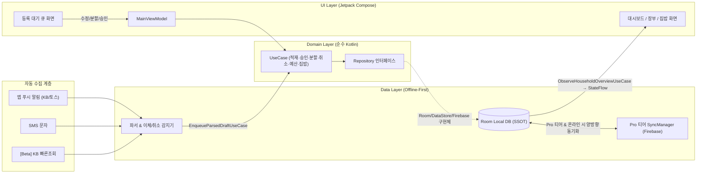

# HouseholdBook 기술 스택 및 아키텍처 명세 (`TECH_STACK.md`)

이 문서는 **HouseholdBook** 프로젝트의 빌드 환경, 라이브러리 버전 표준, 의존성 주입(DI), 오프라인 퍼스트(Offline-First) 데이터베이스, 백그라운드 수집/동기화 등 **기술적 구현 명세**를 별도로 관리하는 문서입니다.
- 도메인 요구사항 및 기능 정책: [GUIDE.md](file:///c:/WorkSpace/Dev/Android/HouseholdBook/GUIDE.md)
- UI/UX 디자인 및 와이어프레임 명세: [DESIGN_GUIDE.md](file:///c:/WorkSpace/Dev/Android/HouseholdBook/DESIGN_GUIDE.md)

---

## 1. 플랫폼 및 빌드 환경 표준 (Build & SDK Standards)

현재 프로젝트의 최신 Gradle/AGP 환경에서 **빌드 충돌 없는 안정성(Stability-First)**을 최우선으로 설정합니다.

| 항목 | 설정 값 | 선정 이유 및 기술적 규칙 |
| :--- | :--- | :--- |
| **Gradle / AGP** | `Gradle 9.5.0` / `AGP 9.3.3` | 프로젝트 기본 구성 유지 |
| **Kotlin** | `2.2.10` (`kotlin-compose` 플러그인) | Compose Compiler 내장 플러그인 사용 |
| **Java / JVM Target** | **`JavaVersion.VERSION_17`** | 최신 Room, Coroutines, KSP 빌드 호환성 보장 (기존 `11`에서 상향) |
| **minSdk** | **`26` (Android 8.0)** | 별도 Desugaring 없이 `java.time.LocalDate`, `YearMonth`, `ZonedDateTime`을 네이티브로 사용하여 월 기준일(`billingStartDay`) 계산의 정확성 보장 |
| **targetSdk / compileSdk** | `37` | Android 최신 권한 및 백그라운드 정책 대응 |

---

## 2. 핵심 기술 스택 및 라이브러리 선정 (Core Libraries)

### 2.1. 의존성 주입 (DI): `Koin Compose` (안정성 최우선)
- **선정 이유**: `AGP 9.3.3` + `Gradle 9.5` + `Kotlin 2.2.10` 최신 환경에서 Dagger/Hilt의 ASM 바이트코드 변환 및 KSP 버전 결합 이슈를 원천 배제하고, 순수 Kotlin 기반으로 100% 충돌 없이 동작하는 **Koin (`io.insert-koin:koin-androidx-compose`)**을 표준 DI로 채택합니다.
- **모듈 구성 (`di/AppModule.kt`)**: 4개 모듈을 `appModules` 리스트로 묶어 `HouseholdBookApp`에서 로드합니다.
  - `databaseModule`: `AppDatabase`(Room, `fallbackToDestructiveMigration`) 및 각 `DAO` 싱글톤
  - `repositoryModule`: 데이터 소스(`UserPreferencesRepository`, `SecureCredentialManager`, `KbQuickInquiryScraper`, `BackgroundWorkScheduler`, `RemoteSyncManager`)와 `domain/repository` 인터페이스 구현체를 `single` + `bind`로 연결 (예: `singleOf(::RoomPendingQueueRepository) { bind<PendingQueueRepository>() }`, `UserPreferencesRepository` → `SettingsRepository`, `FirebaseSharedSyncRepository` → `SharedSyncRepository`, `AndroidMealWidgetRefresher` → `MealWidgetRefresher`)
  - `useCaseModule`: 상태 없는 `domain/usecase` 클래스와 ViewModel용 번들(`PendingQueueUseCases` 등)을 `factoryOf(::...)`로 등록
  - `viewModelModule`: `viewModelOf(::MainViewModel)` (생성자에 UseCase 번들 주입)

### 2.2. 로컬 데이터베이스 (Offline-First SSOT): `Room` + `KSP`
- **구성**:
  - `androidx.room:room-runtime`
  - `androidx.room:room-ktx` (Coroutines & `Flow` 쿼리 지원)
  - `androidx.room:room-compiler` (`ksp` 플러그인으로 코드 생성)
- **설계 원칙**:
  - `FREE` 티어와 `PRO` 티어 모두 **모든 UI 화면은 오직 로컬 Room DB의 `Flow`만 구독**합니다 (Single Source of Truth).
  - 정산 시작일(`billingStartDay`: 1일~28일 또는 말일 `99`) 변경 시에도 데이터 마이그레이션이 필요 없도록, 거래 일시는 항상 `Long` (UTC Epoch Millis)으로 저장하고 `BETWEEN :startMillis AND :endMillis` 범위 쿼리로 집계합니다.

### 2.3. 설정 및 보안 저장소: `DataStore` & `Android Keystore`
- **Jetpack DataStore (`androidx.datastore:datastore-preferences`)**:
  - 현재 선택된 장부 공간 ID (`currentSpaceId`), 유저 티어 (`UserTier: FREE / PRO`), 끼니별 집밥 절약 단가 (`아침/점심/저녁/간식 금액`) 등 비민감 설정값을 반응형 `Flow`로 관리합니다.
- **보안 저장소 (`Android Keystore` + `AES/GCM/NoPadding` Cipher)**:
  - `[Beta]` KB국민은행 무로그인 빠른조회에 필요한 민감 파라미터(계좌번호, 생년월일, 빠른조회 비밀번호 등)는 평문 저장을 금지하며, `core/security/SecureCredentialManager`를 통해 암호화하여 저장합니다.

### 2.4. UI 및 네비게이션: `Jetpack Compose (Material 3)`
- **Compose BOM (`2026.02.01`)**:
  - `material3`, `ui`, `ui-tooling-preview`
  - `androidx.compose.material:material-icons-extended`: 상위/세부 카테고리 아이콘 및 끼니 아이콘 선택기 제공
- **Lifecycle & State**:
  - `androidx.lifecycle:lifecycle-runtime-compose` (`collectAsStateWithLifecycle`)
  - `androidx.lifecycle:lifecycle-viewmodel-compose`
- **Type-Safe Navigation (`androidx.navigation:navigation-compose` + `kotlinx-serialization-json`)**:
  - 문자열 라우트 대신 `@Serializable` data object 라우트(`DashboardRoute`, `PendingQueueRoute`, `LedgerRoute`, `MealSaverRoute`, `SettingsRoute`)를 사용합니다 (`ui/navigation/HouseholdDestinations.kt`).
  - `TopLevelDestination` enum이 라우트·탭 이름·헤더 제목·아이콘을 묶고, `HouseholdNavHost`(`composable<Route> { }`)가 화면을 연결합니다. 현재 탭은 `currentBackStackEntryAsState()` + `hasRoute()`로 판별해 헤더 제목과 플로팅 캡슐 탭 바(`IosFloatingCapsuleTabBar`) 선택 상태에 반영합니다.
  - 탭 전환(`navigateToTopLevel`)은 `popUpTo(시작 화면) { saveState = true }` + `launchSingleTop` + `restoreState`로 탭별 스크롤 상태를 보존하고, 화면 전환 애니메이션은 `EnterTransition.None`으로 꺼서 기존처럼 즉시 바뀝니다. 홈이 아닌 탭에서 뒤로 가기를 누르면 홈으로 돌아갑니다.

### 2.5. 자동 수집 및 `[Beta]` KB 무로그인 빠른조회 스택
1. **푸시 알림 수집 (`NotificationListenerService`)**:
   - Android 프레임워크 기본 API 사용 (`AndroidManifest.xml`에 `BIND_NOTIFICATION_LISTENER_SERVICE` 권한과 함께 등록).
   - 프로세스 종료 후 알림 유실 방지를 위해 `onListenerDisconnected()`에서 `requestRebind()` 호출 필수.
2. **SMS 수집 (`BroadcastReceiver`)**:
   - `android.provider.Telephony.SMS_RECEIVED` 인텐트 필터 등록 (`RECEIVE_SMS` 런타임 권한은 사용자가 SMS 수집 옵션을 켰을 때만 요청하여 권한 거부 시에도 앱 알림 수집은 정상 작동하도록 격리).
3. **`[Beta]` KB국민은행 무로그인 빠른조회 스크래핑 (`OkHttp` + `Jsoup` / `WebView` Fallback)**:
   - `com.squareup.okhttp3:okhttp`: 빠른조회 페이지 HTTP POST 요청 및 세션/인코딩(`UTF-8` / `EUC-KR`) 처리.
   - `org.jsoup:jsoup`: 응답 HTML 테이블에서 거래일시, 출금액, 입금액, 잔액, 적요를 추출.
   - 금융사 웹페이지의 보안 스크립트나 동적 렌더링 변경에 유연하게 대응하기 위해 `QuickInquiryFetcher` 인터페이스로 추상화하며, 필요 시 Headless `WebView` 브릿지 구현체로 교체 가능하도록 설계합니다.

### 2.6. Pro 티어 멀티유저 동기화 및 백그라운드 작업
1. **현재 동기화 방식 (`data/sync/RemoteSyncManager.kt`)**:
   - 거래 저장·취소·삭제 직후 `syncIfEligible()`을 호출해 `PRO` + 공유 활성화 상태일 때만 Firestore에 반영합니다.
   - 업로드 대상은 **`공통 생활비` 공간의 `PENDING_UPLOAD` 내역뿐**이며, `PENDING_DELETE` 내역은 원격 문서를 지운 뒤 로컬에서 제거합니다.
   - `shared_spaces/{inviteCode}/transactions`에 `SnapshotListener`를 연결해 상대방 변경(추가·수정·삭제)을 Room에 반영합니다. 충돌은 `updatedAt` 기준 LWW(Last-Write-Wins)로 해결합니다.
   - 초대번호는 `generateInviteCode()`가 `SecureRandom`으로 `HB-XXXX-XXXX` 형식(31자 × 8자리)을 발급합니다.
   - Firestore 구조: `users/{uid}`(프로필·플랜), `invitations/{inviteCode}__{partnerEmail}`(초대장), `shared_spaces/{inviteCode}`(방 정보 + `memberEmails` 멤버 명단), `shared_spaces/{inviteCode}/transactions/{remoteId}`(공통 생활비 내역).
   - 동기화 전 `ensureRoomMembership()`으로 방 문서의 `memberEmails`에 내 이메일이 있는지 확인하고, 방이 없으면 내가 방장인 새 방을 만듭니다. 멤버가 아니면 업로드·수신을 하지 않습니다.
   - 초대 시 상대 이메일을 먼저 `memberEmails`에 추가한 뒤 초대장을 만들고, 상대가 로그인하면 `PENDING` 초대장을 찾아 자동 연결(`ACCEPTED`)합니다. 초대번호만 입력해서 다른 방에 들어가는 방식은 없습니다.
   - 클라우드 기능은 **구글 공식 인증 창(`OAuthProvider("google.com")`)으로 로그인한 계정만** 사용합니다. 익명 로그인은 쓰지 않으며, 이메일을 직접 입력해도 인증 창에서 같은 계정으로 확인해야 합니다.
2. **WorkManager (`androidx.work:work-runtime-ktx`) — `data/work/`**:
   - `BackgroundWorkScheduler`(Koin single)가 모든 예약을 담당합니다.
   - `SyncWorker`: `syncIfEligible()`이 오프라인 등 일시적 오류로 실패하면 `NetworkType.CONNECTED` 조건의 1회 작업(`household_shared_sync_once`, KEEP, 지수 백오프 30초)을 예약해 인터넷 연결 즉시 `PENDING_UPLOAD / PENDING_DELETE`를 반영합니다. 놓친 변경 보정을 위해 6시간 주기 작업(`household_shared_sync_periodic`)도 앱 시작 시 등록합니다. 혼자 쓰기·로그인 안 됨 등 재시도로 해결되지 않는 경우는 바로 종료하고, 최대 8회까지만 재시도합니다.
   - `QuickInquiryWorker`: 설정의 **KB 계좌 내역 자동 불러오기 [Beta]**를 켜면 3/6/12/24시간 주기(`household_kb_quick_inquiry`, UPDATE)로 빠른조회를 실행해 신규 내역을 대기 큐에 적재합니다. 계좌 정보가 없으면 켤 수 없고, 실패 시 3회까지 재시도합니다.
   - Worker는 `KoinComponent`로 UseCase를 주입받습니다 (기본 WorkerFactory 사용): `SyncWorker` → `SyncPendingSharedChangesUseCase`, `QuickInquiryWorker` → `IsKbAutoInquiryReadyUseCase` + `RunKbQuickInquiryUseCase`. 알림 리스너·SMS 리시버는 `IngestRawNotificationUseCase`, 위젯은 `RecordHomeCookedMealUseCase`·`GetMealWidgetSummaryUseCase`를 사용합니다.
3. **Firebase 연동 및 빌드 독립성**:
   - `app/google-services.json`이 있을 때만 `com.google.gms.google-services` 플러그인을 적용합니다 (`app/build.gradle.kts`).
   - 런타임에는 `RemoteSyncManager.isFirebaseConfigured()`로 Firebase 초기화 여부를 확인하고, 설정이 없으면 로컬 전용으로 동작합니다. (별도 `RemoteSyncDataSource` 인터페이스 분리는 예정)
4. **보안 규칙 (`firestore.rules`)**:
   - 모든 규칙은 `sign_in_provider == 'google.com'` + `email_verified` 인 구글 로그인 사용자만 허용합니다 (익명 로그인 차단).
   - `users/{uid}`: 본인만 읽기·쓰기. `uid`/`email` 필드는 토큰 값과 같아야 합니다.
   - `shared_spaces/{inviteCode}`: 방 문서는 `memberEmails`에 포함된 멤버만 조회·수정합니다. 새 방은 `HB-XXXX-XXXX` 형식(`isValidInviteCode`)일 때만, 나 혼자 멤버·방장으로 만들 수 있습니다. 방장 정보는 바꿀 수 없고 멤버는 최대 10명입니다. 하위 `transactions`도 멤버만 읽고 쓰며 `remoteId`·`spaceId`·`amount`·`updatedAt`을 검증합니다.
   - `invitations/{inviteCode}__{email}`: 방 멤버만, 이미 `memberEmails`에 추가된 상대에게만 만들 수 있습니다. 초대한 사람·초대받은 사람만 볼 수 있고, 초대받은 사람은 수락/거절 상태만 바꿀 수 있습니다.
   - 규칙 파일은 앱 코드와 함께 바뀌므로, 앱 배포 전 `firebase deploy --only firestore:rules`로 게시해야 합니다. 예전 경로(`shared_spaces/__user_profiles__`, `__invitations__`, 방 문서 없는 예전 방)는 새 규칙에서 접근할 수 없습니다.
   - 남은 과제: `userTier`는 아직 사용자가 직접 쓰는 값이라 서버에서 PRO 여부를 강제하지 못합니다 (결제 검증 후 Cloud Functions가 기록하는 방식 필요). 초대장은 로그인 시 자동 수락되므로, 수락 확인 화면 추가를 검토해야 합니다.

---

## 3. 버전 카탈로그 구성 표준 (`gradle/libs.versions.toml`)

AI 에이전트가 `gradle/libs.versions.toml`을 업데이트할 때 사용할 권장 구성입니다.

```toml
[versions]
agp = "9.3.3"
kotlin = "2.2.10"
ksp = "2.2.10-2.0.2"
coreKtx = "1.19.0"
lifecycleRuntimeKtx = "2.9.0"
activityCompose = "1.13.0"
composeBom = "2026.02.01"
navigationCompose = "2.9.0"
room = "2.7.2"
datastore = "1.1.7"
koin = "4.1.0"
coroutines = "1.10.2"
serializationJson = "1.8.1"
workManager = "2.10.1"
okhttp = "4.12.0"
jsoup = "1.19.1"
firebaseBom = "33.10.0"
googleServices = "4.4.2"
junit = "4.13.2"
junitVersion = "1.3.0"
espressoCore = "3.7.0"

[libraries]
# AndroidX Core & Lifecycle
androidx-core-ktx = { group = "androidx.core", name = "core-ktx", version.ref = "coreKtx" }
androidx-lifecycle-runtime-ktx = { group = "androidx.lifecycle", name = "lifecycle-runtime-ktx", version.ref = "lifecycleRuntimeKtx" }
androidx-lifecycle-runtime-compose = { group = "androidx.lifecycle", name = "lifecycle-runtime-compose", version.ref = "lifecycleRuntimeKtx" }
androidx-lifecycle-viewmodel-compose = { group = "androidx.lifecycle", name = "lifecycle-viewmodel-compose", version.ref = "lifecycleRuntimeKtx" }
androidx-activity-compose = { group = "androidx.activity", name = "activity-compose", version.ref = "activityCompose" }

# Compose
androidx-compose-bom = { group = "androidx.compose", name = "compose-bom", version.ref = "composeBom" }
androidx-compose-ui = { group = "androidx.compose.ui", name = "ui" }
androidx-compose-ui-graphics = { group = "androidx.compose.ui", name = "ui-graphics" }
androidx-compose-ui-tooling = { group = "androidx.compose.ui", name = "ui-tooling" }
androidx-compose-ui-tooling-preview = { group = "androidx.compose.ui", name = "ui-tooling-preview" }
androidx-compose-ui-test-manifest = { group = "androidx.compose.ui", name = "ui-test-manifest" }
androidx-compose-ui-test-junit4 = { group = "androidx.compose.ui", name = "ui-test-junit4" }
androidx-compose-material3 = { group = "androidx.compose.material3", name = "material3" }
androidx-compose-material-icons-extended = { group = "androidx.compose.material", name = "material-icons-extended" }

# Navigation & Serialization
androidx-navigation-compose = { group = "androidx.navigation", name = "navigation-compose", version.ref = "navigationCompose" }
kotlinx-serialization-json = { group = "org.jetbrains.kotlinx", name = "kotlinx-serialization-json", version.ref = "serializationJson" }

# Room Database (Offline-First SSOT)
androidx-room-runtime = { group = "androidx.room", name = "room-runtime", version.ref = "room" }
androidx-room-ktx = { group = "androidx.room", name = "room-ktx", version.ref = "room" }
androidx-room-compiler = { group = "androidx.room", name = "room-compiler", version.ref = "room" }

# DataStore
androidx-datastore-preferences = { group = "androidx.datastore", name = "datastore-preferences", version.ref = "datastore" }

# Dependency Injection (Koin - Conflict-Free with AGP 9.x)
koin-android = { group = "io.insert-koin", name = "koin-android", version.ref = "koin" }
koin-androidx-compose = { group = "io.insert-koin", name = "koin-androidx-compose", version.ref = "koin" }

# Coroutines & WorkManager
kotlinx-coroutines-android = { group = "org.jetbrains.kotlinx", name = "kotlinx-coroutines-android", version.ref = "coroutines" }
androidx-work-runtime-ktx = { group = "androidx.work", name = "work-runtime-ktx", version.ref = "workManager" }

# Network & HTML Scraping ([Beta] KB 무로그인 빠른조회용)
okhttp = { group = "com.squareup.okhttp3", name = "okhttp", version.ref = "okhttp" }
jsoup = { group = "org.jsoup", name = "jsoup", version.ref = "jsoup" }

# Firebase (Pro 티어 함께 쓰기)
firebase-bom = { group = "com.google.firebase", name = "firebase-bom", version.ref = "firebaseBom" }
firebase-auth = { group = "com.google.firebase", name = "firebase-auth" }
firebase-firestore = { group = "com.google.firebase", name = "firebase-firestore" }

# Testing
junit = { group = "junit", name = "junit", version.ref = "junit" }
androidx-junit = { group = "androidx.test.ext", name = "junit", version.ref = "junitVersion" }
androidx-espresso-core = { group = "androidx.test.espresso", name = "espresso-core", version.ref = "espressoCore" }
kotlinx-coroutines-test = { group = "org.jetbrains.kotlinx", name = "kotlinx-coroutines-test", version.ref = "coroutines" }

[plugins]
android-application = { id = "com.android.application", version.ref = "agp" }
kotlin-compose = { id = "org.jetbrains.kotlin.plugin.compose", version.ref = "kotlin" }
kotlin-serialization = { id = "org.jetbrains.kotlin.plugin.serialization", version.ref = "kotlin" }
ksp = { id = "com.google.devtools.ksp", version.ref = "ksp" }
google-services = { id = "com.google.gms.google-services", version.ref = "googleServices" }
```

---

## 4. 레이어별 아키텍처 및 데이터 흐름 규칙 (Clean Architecture + UDF)



### 4.1. 아키텍처 불변 규칙
1. **UI Layer (`ui/`)**:
   - 모든 화면(`Screen`)은 상태를 가진 `ViewModel` 연결 컴포넌트와 순수 상태만 전달받는 Stateless `Content` Composable로 분리하여 `@Preview` 및 UI 테스트가 용이하도록 작성합니다.
2. **Domain Layer (`domain/`)**:
   - Android 프레임워크 의존성(`Context` 등)을 갖지 않는 순수 Kotlin 패키지로 유지합니다.
   - `BillingCycleCalculator`(월 기준일 주기 계산), 이체/카드대금 감지, `CancelMatcher`(취소 내역 매칭)는 모두 단위 테스트(Unit Test)가 가능하도록 Android 의존성 없는 순수 로직으로 유지합니다.
   - 현재 위치: `core/common/BillingCycleCalculator.kt`, `data/ingestion/parser/FinancialParserEngine.kt`(이체 감지 포함 — 별도 `TransferDetector` 클래스 없음), `data/ingestion/parser/CancelMatcher.kt`. 3분 이내 이체 쌍 감지는 `EnqueueParsedDraftUseCase`에서 수행합니다.
   - **UseCase (`domain/usecase/`)**: 대기 큐 적재·승인·분할·취소 연결, 거래, 카테고리, 예산 요약, 집밥, 동기화 규칙을 담당하며 `domain/repository/HouseholdRepositories.kt`의 인터페이스에만 의존합니다. 여러 저장을 묶는 원자성은 `TransactionRunner`(구현: `RoomTransactionRunner` = `withTransaction`)로 보장합니다.
   - Room Entity(`data/local/entity`)는 별도 매핑 없이 도메인 모델로 함께 사용합니다. 구글 로그인 창이 필요한 `SharedSyncRepository.signInWithGoogleAccount()`는 Activity를 `uiHost: Any?`로 받아 도메인에 Android 타입이 드러나지 않게 합니다.
   - 테스트: `app/src/test/.../HouseholdBookCoreTest.kt`, `CancelMatcherAndInviteCodeTest.kt`, `LastDayBillingCycleTest.kt`, `domain/usecase/PendingQueueUseCasesTest.kt`, `domain/usecase/BudgetMealAndSyncUseCasesTest.kt` (메모리 저장소 `FakeRepositories.kt` 사용)
3. **Data Layer (`data/`)**:
   - `Room` 트랜잭션을 적극 활용하여, 대기 큐에서 **[분할 승인(Split)]** 실행 시 `PendingTransaction 상태 변경(APPROVED)`과 `다중 TransactionEntity 삽입`이 원자적(Atomic)으로 처리되도록 보장합니다. UseCase는 `TransactionRunner.runInTransaction { }`을 호출하고, `RoomTransactionRunner`가 `database.withTransaction`으로 실행합니다.
   - `data/repository/RoomRepositories.kt`의 구현체는 DAO 위임만 하며 비즈니스 규칙을 두지 않습니다.
